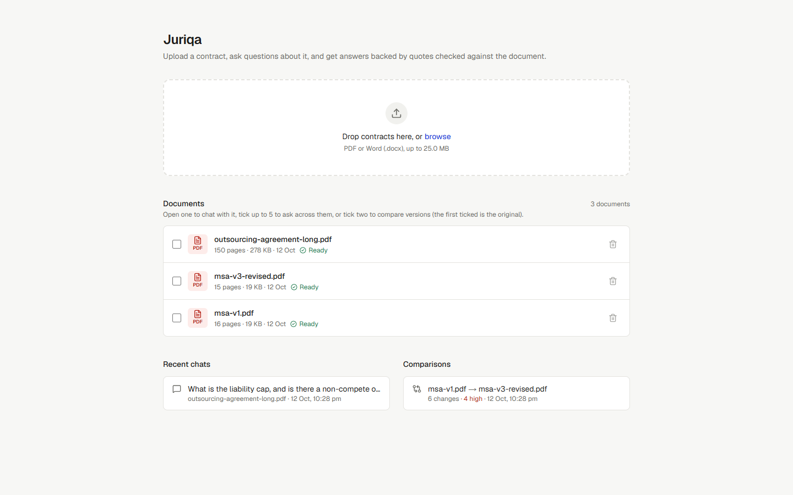
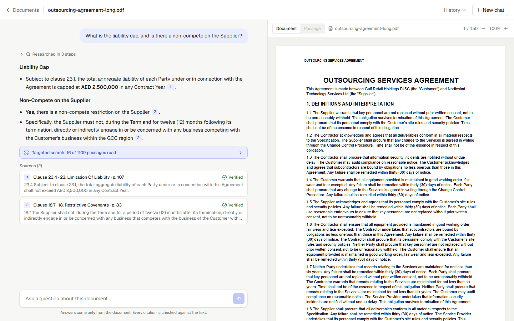
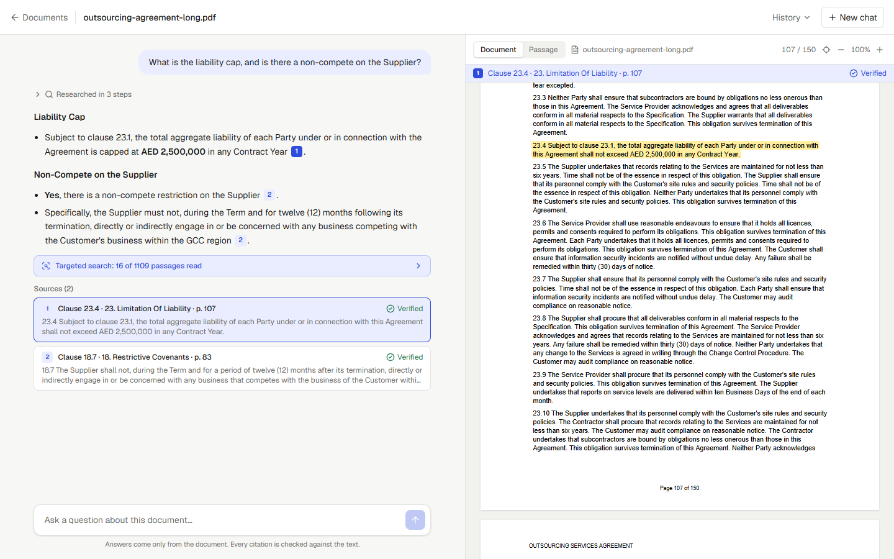
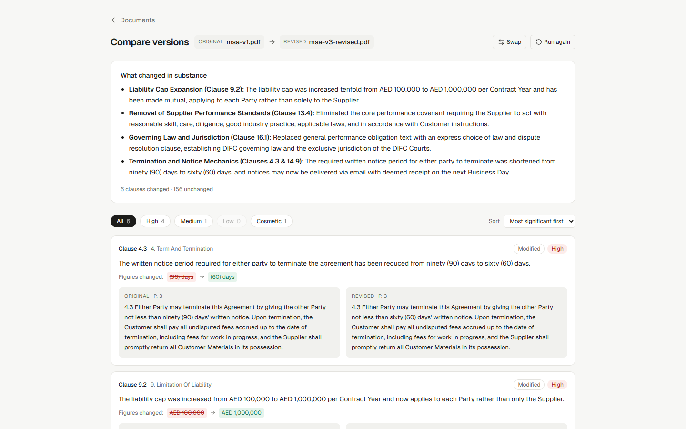

# Juriqa

A web app for analysing legal contracts. Upload a contract (PDF or DOCX), ask questions about it, and get answers that cite the exact passages they come from. Click a citation and the original document opens beside the chat, scrolled to the passage, with it highlighted.

**Live app:** https://juriqa.vercel.app · **Demo video:** _add the link here_ · **Design notes:** [DESIGN.md](DESIGN.md) · **Submission note:** [NOTE.md](NOTE.md)

## What it does

| Feature | How it works |
|---|---|
| **Upload** | PDF and DOCX only, checked by file content, not just the extension. 25 MB limit. Live progress while processing ("Extracting text (page 40 of 150)"). Scanned PDFs with no text are rejected with a clear message. Partly scanned PDFs are accepted with a warning, and their image pages count as unread. |
| **Library** | List, open and delete documents. Tick up to 5 to ask across them, or tick 2 to compare versions. Recent chats and comparisons can be reopened. |
| **Chat** | Answers stream in as they are written, with live research status ("Searching for “termination for convenience”"). A Stop button keeps whatever was written. Chat history is saved per document. |
| **Verified citations** | Every statement cites a passage ID. The app shows the real passage text, and checks every citation against what the AI actually retrieved. A citation that fails is struck through and flagged, never shown as genuine. |
| **Out-of-scope questions** | A router refuses questions that are off-topic or ask for general legal knowledge, and suggests a document-based question instead. |
| **Large documents** | A 150-page contract works. Answers show a coverage badge: *Full document reviewed*, *Targeted search (N of M passages)* or *Incomplete*. The app never says something is absent unless it read the whole document. |
| **Citation highlighting** | PDFs are rendered with pdf.js and the cited lines are highlighted, including passages that span several lines or cross a page break. DOCX files are rendered as HTML with the cited paragraph highlighted. |
| **Multi-document questions** | Questions across up to 5 documents get comparative answers, with tables when comparing terms. Each citation is tagged with its document and verified against that document only. |
| **Document comparison** | Clause-level differences between two versions, a plain-language overview, and a significance level per change (High / Medium / Low / Cosmetic) that you can filter and sort by. Changed amounts, dates and periods are detected by code and always rated High. |
| **Part C: Agentic research (option 2)** | The AI researches with tools (`search_document`, `get_context`, `get_section`, `list_clauses`, `read_entire_document`) in a loop of up to 6 rounds. Its progress is shown live, and malformed or invented tool calls are handled without crashing. |

## Screenshots

| Upload and library | Chat with verified citations |
|---|---|
|  |  |

| Citation highlighting | Document comparison |
|---|---|
|  |  |

## How it works

### Retrieval: agentic research, no vector database
Documents are split into passages of 50–150 words along clause and paragraph boundaries, never mid-sentence, and stored in Postgres with a full-text search index. The AI never gets the whole document pushed into its prompt. It calls tools to look things up, reads the results, and decides what to look at next. Each passage has an ID such as `D1-C87` (document 1, passage 87).

### Quote verification: cite by ID
The AI does not retype quotes. It cites passage IDs, and the app displays the stored text of those passages, so a quote can't be paraphrased or invented. Before an answer is shown, every cited ID is checked:
- it must exist, and
- its text must have been returned to the AI by a tool during this answer (or in a verified earlier answer in the same chat).

Anything else is flagged as unverified and struck through. Positions and page numbers come from the stored passage, never from the AI. Because quotes are never matched as strings, whitespace differences from text extraction can't cause false rejections.

### Large documents and coverage
The app records which passages were actually sent to the AI for each answer. This is computed by code, not taken from the AI's claims. The AI ends each answer with a hidden tag (`found` / `not_found` / `partial`, per document). If it says something is missing and it hasn't read the whole document, the draft answer is discarded and the app reads every passage in parallel batches (a 150-page contract takes about 10 seconds) before answering again. Summaries and "list all…" questions read the whole document up front. Any batch that fails is recorded, and the answer names the pages that weren't read.

### Comparison
Clauses are matched between versions by clause number, then by identical text (to catch renumbering), then by similarity. Unchanged, renumbered and punctuation-only clauses are classified by code. The remaining changes are assessed by the AI in parallel batches. Figures (amounts, percentages, periods, dates) are compared by code, ignoring cross-references like "clause 12", and any change to them forces High significance.

## Tech stack
Next.js 16 (App Router) · TypeScript · Tailwind CSS 4 · Postgres on Neon (Drizzle ORM) · Vercel Blob · Google Gemini (`@google/genai`) · pdf.js (`unpdf` on the server, `pdfjs-dist` in the browser) · mammoth for DOCX

## Run locally

Requirements: Node 20+, a Postgres database (a free Neon project works), a Gemini API key, and a Vercel Blob store.

```bash
git clone https://github.com/Ved2604/juriqa.git
cd juriqa
npm install            # also copies the pdf.js worker into public/
cp .env.example .env.local
```

Fill in `.env.local`:

| Variable | Purpose |
|---|---|
| `DATABASE_URL` | Postgres connection string |
| `GEMINI_API_KEY` | Gemini API key |
| `GEMINI_MODEL` | Main model, e.g. `gemini-3.8-flash` |
| `GEMINI_FALLBACK_MODEL` | Optional: used when the main model is overloaded or out of quota |
| `GEMINI_BASE_URL` | Optional: custom API endpoint |
| `BLOB_READ_WRITE_TOKEN` | Vercel Blob token (file storage) |

```bash
npm run db:push        # create the tables
npm run dev            # http://localhost:3000
```

`/api/health` checks the database and Gemini connection.

**Test documents** are in [`test-docs/`](test-docs), generated by the scripts in [`scripts/`](scripts):
- `msa-v1.pdf` / `.docx`: a 16-page services agreement
- `msa-v3-revised.pdf`: v1 with six known changes, for testing comparison
- `outsourcing-agreement-long.pdf`: 150 pages, with facts planted on pages 83, 107 and 136
- `scanned.pdf`: image only, to test rejection

## What is finished and what is not

**Finished and tested:** everything in the feature table above.
- Upload, rejection of wrong file types and scanned PDFs.
- Streaming answers, Stop, and chat history.
- Citation verification, with unverified citations flagged.
- Router refusals.
- Coverage and the full-document safety net on the 150-page test contract (facts on pages 83, 107 and 136 found in about 10 seconds; a "not in the document" answer after reading all 150 pages in about 34 seconds).
- PDF highlighting across lines and page breaks; DOCX highlighting.
- Multi-document comparative answers.
- Version comparison (all six planted changes found and rated correctly).
- Mobile layouts.

**Not finished or not fully tested. Please read before relying on these:**
- **Tested on generated contracts, not real-world ones.** Real contracts with two-column layouts, complex tables, footnotes or unusual numbering may split into passages less cleanly. That affects how tidy citations look, not whether they are genuine.
- **Word auto-numbering is not extracted.** Clause numbers that Word generates automatically ("1.", "2.1") are not in the extracted text, so DOCX citations may lack clause labels, and DOCX comparisons fall back to matching by text similarity.
- **Highlighting works per line.** If a passage starts or ends mid-line, the whole line is highlighted.
- **Citations prove where text came from, not what it means.** The app guarantees a cited passage is real and was read. It does not check that the passage actually supports the sentence citing it.
- **Not exercised by a real failure:** the "Incomplete" coverage state for a failed scan batch, and partly scanned PDFs. The code paths exist, but I couldn't trigger a real failure to test them.
- **No OCR:** scanned PDFs are rejected.
- **No login, as the assignment specifies.** Uploaded files sit at unguessable but public Blob URLs. A multi-user version would need accounts and private storage.
- **Response times:** typical answers take about 9 seconds and full-document answers 15–35 seconds. Each answer streams over one request, so it is bounded by Vercel's function time limit (300 s configured).

No optional extras were attempted.
